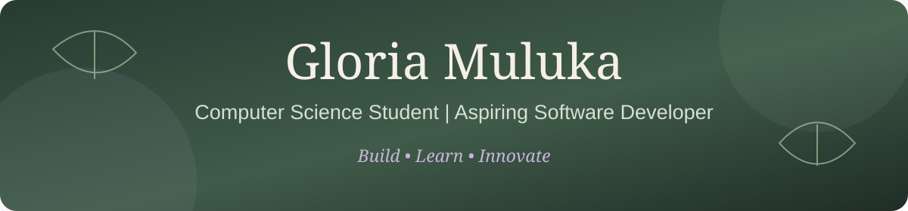

<p align="center">
  
</p>


### About Me

I'm a Computer Science student at Strathmore University with a passion for building things with code and solving real-world problems through technology.

I enjoy exploring different areas of software development, from backend systems and database design to frontend development.

-  Currently pursuing Informatics and Computer Science.
-  Interested in software engineering and full-stack development.
-  Always learning, experimenting and building new projects.
-  Open to internships, collaborations and opportunities to grow.


---

## Technical Skills

**Programming Languages**
<p>
  
  
  
</p>

**Frontend & Backend Development**
<p>
  
  
  
  
</p>

**Databases & Development Tools**
<p>
  
  
  
</p>


---

## Education

**Strathmore University** | Nairobi, Kenya

2024 – Present

Bachelor of Science in Informatics and Computer Science

Relevant Coursework:
- Object-Oriented Programming
- Database Management
- Web Technologies
- Systems Analysis

**Makueni Girls High School**

2020 – 2023

Kenya Certificate of Secondary Education (KCSE) – Grade B+

**NYS Huduma Academy**

2008 – 2019

Kenya Certificate of Primary Education (KCPE)


---

## Featured Projects

### 1. Finance Manager
**Python | File Handling**

A console-based productivity application designed to help users manage their money and monitor how they spend their money at certain times.

**Key Features**
- Add, view and delete receipts.
- Track money and how it was spent on different activities.
- Calculate weekly spendature, sets recommendation for how to improve.

https://github.com/ria-bot/Org-life

---

### 2. Distributed Drink Ordering System
**Java | SQLite | Client-Server Architecture**

A distributed ordering application that simulates a multi-user drink ordering environment.

**Key Features**
- Client-server communication.
- Database schema design.
- Inventory tracking.
- SQL queries for sales reporting.

https://github.com/ria-bot/Drink-Ordering-System

### 3. Pixel Flower Quest
**HTML | CSS | JavaScript**

An interactive flower-gifting web application that allows users to select flowers, personalize gifts and generate beautiful gift certificates.

**Key Features**
- Interactive flower selection.
- Personalized gifting experience.
- Dynamic gift certificate generation.
- Animated pixel-art effects.

🔗 [View Repository](https://github.com/ria-bot/Flowers-For-You)

---

### 4. Strathmore Assignment Hub
**Python | Tkinter | OAuth 2.0**

A cross-platform desktop application that brings upcoming assignments from Google Classroom and Strathmore eLearning into interactive desktop sticky notes.

**Key Features**
- Assignment aggregation.
- Automated platform authentication.
- Encrypted local credential storage.
- Desktop notification-style sticky notes.
- Linux and Windows support.

🔗 [View Repository](https://github.com/ria-bot/Assignment-Checker)

---

### 5. Choose Your Ending
**HTML | CSS | JavaScript**

An interactive browser-based project.

🔗 [View Repository](https://github.com/ria-bot/Choose-you-ending)


---

## Certifications & Training

- **Moringa School** – Generative AI Essentials for Software Developers
- **Cybersecurity / Splunk Training**


---

## Beyond Coding

When I'm not writing code, I enjoy:

-  Swimming
-  Tennis
-  Gaming
-  Hiking
-  Outdoor Adventuring
-  Exploring new ideas and technologies
-  Learning new ways to solve problems

---

## Let's Connect!

- **GitHub:** [ria-bot](https://github.com/ria-bot)
- **LinkedIn:** [Gloria Muluka](https://www.linkedin.com/in/gloria-muluka-10896a3a2/)
- **Email:** [Contact Me](mailto:gloriamuluka06@gmail.com)

---

<p align="center">
  <i>"Thank you for reading my portfolio."</i>
</p>
```
